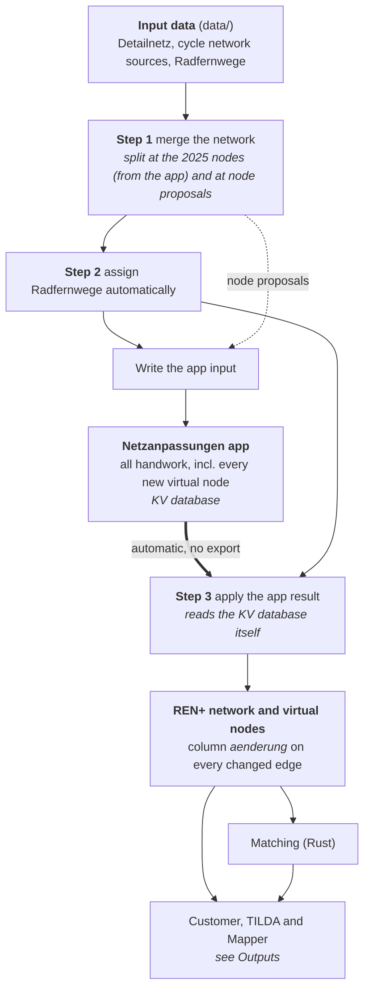
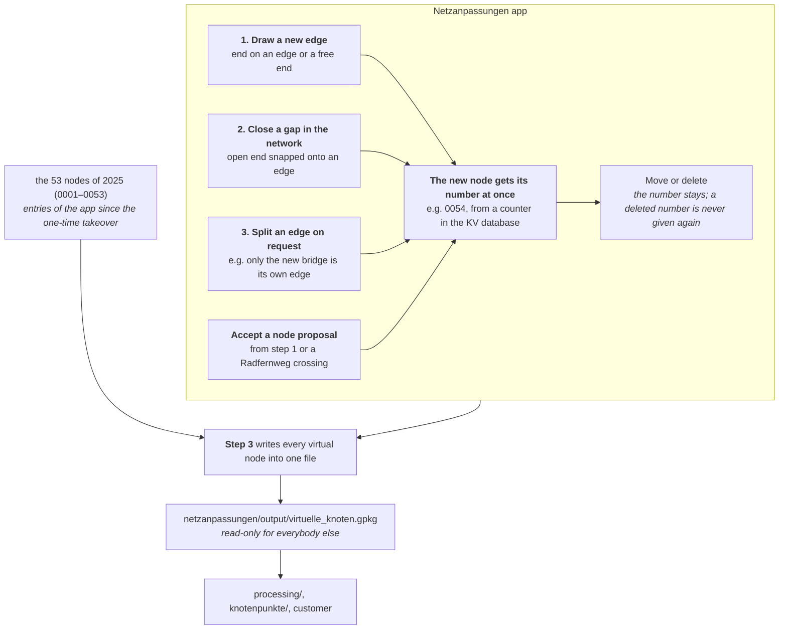
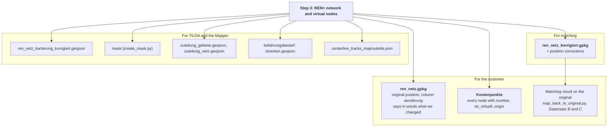

# Network pipeline: from the raw network to the customer network and the working network

As of 2026-11-19. Two repos take part: this repo `infravelo-radnetz` (Python, all network files) and [`infravelo-apps`](https://github.com/FixMyBerlin/infravelo-apps) with the **Netzanpassungen app** (`netzanpassungen/` there, all handwork, stored in the app's KV database). The app itself is described in its [README](https://github.com/FixMyBerlin/infravelo-apps/blob/main/netzanpassungen/README.md). The state before this pipeline is tagged `old-pipeline-2026-11`.

**Language rule for both repos:** code, comments, file names, commit messages and our documents are in English. The app UI and the customer's data fields (`element_nr`, `verkehrsrichtung`, `routen_fernradweg`, `fahrbahn_typ`, …) stay German.

## Principle

- **All handwork happens in the Netzanpassungen app** and lives only in its KV database: Radfernweg gaps, new edges, position corrections, direction, carriageway, exclusion, and **every virtual node**. The app gives the numbers of new virtual nodes itself.
- **The app never receives anything from the end of the pipeline.** Its input holds only raw data and what is computed automatically, so it can be regenerated and uploaded at any time without duplicates.
- **Step 3 reads the app's entries directly from the KV database** (read-only). There is no manual export; the export „Alle Einträge“ stays as a fallback (`--export`).
- **After a one-time takeover only the data from the app count; old lists are an archive** (`netzanpassungen/one_time_import/`): the old override lists of edges and the 53 virtual nodes of 2025. Steps 1 and 3 and the app input read the 53 from the KV database too (`VITE_KV_*` in `.env`).
- The result of the app is written only to `output/`, never to `data/`.

## Overview

Everything from step 1 to the TILDA outputs runs with one command: `./run_pipeline.sh` (options `--gebiet`, `--export`, `--ohne-tilda`; see the comment at its top).

## Virtual nodes

A virtual node is a node the Detailnetz does not have. Every one has a four-digit number that never changes (rules: [`data/VIRTUELLE-KNOTENPUNKTE.md`](../data/VIRTUELLE-KNOTENPUNKTE.md)).

- **The 53 nodes of 2025** (`0001`–`0053`) are entries of the app (`herkunft: rvn_2025`, entry ids `rvn2025-0001` …). The app took them over once by itself when a logged-in user opened the area `berlin`; the delivery is an archive in `netzanpassungen/one_time_import/2025/Virtuelle-Knotenpunkte.gpkg` and the pipeline does not read it. Their id in the 2025 delivery is in `id_rvn_2025` (e.g. `V1112`); the app finds old references through it. Steps 1 and 3 read them from the KV database (`read_registry()`, needs `VITE_KV_*` in `.env`) and stop if not all 53 are there.
- **Every new node is set in the app**, in one of these cases: (1) a new edge ends on an existing edge or ends freely; (2) an open end of the network is snapped onto an edge (an end snapped onto a node needs no new node); (3) an edge is split on request, e.g. where only a new bridge is to be its own edge; (4) a node proposal is accepted. The app takes the number from a counter in its KV database (`zaehler:virtuelle-knoten`).
- **Node proposals:** where REN+ edges meet without a node, step 1 writes a proposal with an id `P<x>-<y>` (EPSG:25833 metres): 286 on all of Berlin (112 on the interior of another edge, 162 where edge ends meet, 12 open ends). They show in the app's queue „Knotenvorschläge Netz“; accepting one gives it a number. Until then the edges end at the `P…` id and step 3 lists them in `korrekturen_konflikte.csv`.
- **Moving and deleting** also happen in the app, for the 53 of 2025 too. A deleted node stays in the KV database, its number stays taken.
- **Step 3** writes `netzanpassungen/output/virtuelle_knoten.gpkg` (every node of the app, the 53 of 2025 included, active and deleted). Everything else reads virtual nodes from there (`read_active()` in `data/virtuelle_knotenpunkte.py`). Nobody edits a node file by hand.

Every virtual node that is an end of a REN+ edge is a Knotenpunkt and is rated like any other node not rated in 2025 (`knotenpunkte/README.md`).

## Outputs

- **`ren_netz.gpkg` (customer):** the raw network split at all virtual nodes, plus Radfernwege (assigned automatically and by hand), drawn edges, direction, carriageway, excluded edges, in **original position**. Every change is described in the text column `aenderung` (German, one sentence per change, joined with „; “) and marked in its own columns (`quelle`, `verkehrsrichtung_korrigiert`, `ausgeschlossen`, `element_nr_eingabe`, `eintrag_ids`, …). There are no separate documentation files.
- **`ren_netz_korrigiert.gpkg` (working):** the same plus the position corrections; matching and mapping use it. `map_back_to_original.py` maps the matching result back onto `ren_netz.gpkg` by `element_nr`.
- Both also come as the filtered mapping version (`…_kartierung…`).

## The steps

Script and file names (renamed with this rebuild):

| before                                                             | now                                     |
| ------------------------------------------------------------------ | --------------------------------------- |
| `ren-network/unify_networks.py`, `netz_zusammenfuehren.py`         | `ren-network/merge_networks.py`         |
| `ren-network/output/ren_netz_gesamt.gpkg`                          | `ren-network/output/ren_netz_roh.gpkg`  |
| `netzanpassungen/radfernwege_zuordnen.py`                          | `netzanpassungen/match_cycle_routes.py` |
| `netzanpassungen/export_app_daten.py`, `app_eingabe_schreiben.py`  | `netzanpassungen/write_app_input.py`    |
| `netzanpassungen/import_app_export.py`, `app_ergebnis_anwenden.py` | `netzanpassungen/apply_app_result.py`   |
| `ren-network/zurueck_aufs_original.py`                             | `ren-network/map_back_to_original.py`   |
| `netzanpassungen/einmalige_uebernahme/`                            | `netzanpassungen/one_time_import/`      |

**Step 1: merge the network** (`ren-network/merge_networks.py`). Radverkehrsnetz, Radschnellverbindungen and Hauptstraßennetz become one raw network; `element_nr` through the node pairs of the Detailnetz. The REN+ edges are split at the active ones of the 53 nodes of 2025 (read from the app's KV database) and at the node proposals, and every edge gets a unique `element_nr` from its end nodes (`<von>_<bis>.<nn>`; split pieces keep the old number in `ursprung_element_nr`). Result `ren_netz_roh.gpkg` and `ren-network/output/virtuelle_knoten_vorschlaege.gpkg`.

**Step 2: assign Radfernwege automatically** (`netzanpassungen/match_cycle_routes.py`). Every Radfernweg is laid onto REN+ and the Detailnetz (rule below). Clearly matching REN+ edges get `routen_fernradweg`; clearly matching Detailnetz edges not in REN+ yet are taken in (`grund_aufnahme = radfernweg`). What is left becomes a **gap** with a fixed id.

**Write the app input** (`netzanpassungen/write_app_input.py`). `netzanpassungen_<gebiet>.json` with the Detailnetz, `ren_netz_auto.gpkg` as REN+, the Radfernwege, their sections, and as `knoten` the Detailnetz nodes and the proposals of step 1 (`vorschlag = true`); no virtual nodes otherwise, the app has the 53 of 2025 as entries. Uploaded in the app, also repeatedly.

**Step 3: apply the app result** (`netzanpassungen/apply_app_result.py`). Reads the app's entries of the area from the KV database (`netzanpassungen/kv_entries.py`; settings `VITE_KV_*` in `.env`, see `.env.example`), or with `--export` a file „Alle Einträge“. Applies new edges, virtual nodes (they split their host edge), accepted proposals (their `P…` id becomes the number), gap assignments, corrections, direction, carriageway and exclusion, and writes `ren_netz.gpkg`, `ren_netz_korrigiert.gpkg`, their Kartierung, `netzanpassungen/output/virtuelle_knoten.gpkg`, `touristische_kanten.gpkg` and `korrekturen_konflikte.csv`. A virtual node without a number (an app entry that has not been numbered yet) is a conflict and splits nothing. Section assignments may name a part of an edge, `<edge key>@<von>-<bis>` (whole metres from the start of the edge): `detailnetz:<ref>@a-b` takes in only that piece of the Detailnetz line as a new row (its `element_nr` built from the nodes at its ends, never giving the route to REN+ rows with the same number), `ren:<ref>@a-b` and `neu:<id>@a-b` give the route to the parts inside a-b after the split at the virtual nodes; for the relaying a part names its whole edge, so an automatic route of that edge stays.

**Old override lists.** `rvn_korrekturen.csv`, `opposite_edge_overwrite_element_nr.txt` and `ausschluss_element_nr.csv` are the lists of 2025. They were converted into `netzanpassungen/one_time_import/altlisten_korrekturen.json` (loaded once into the app) and are kept as archive in `netzanpassungen/one_time_import/2025/`. Until the customer delivery on the Radvorrangnetz (RVN) the RVN processing still reads `rvn_korrekturen.csv` from there (`enrich_rvn_with_detailnetz.py --netz rvn`), and the map-matching evaluation marks the entries of the opposite-edge list.

## Assignment rule Radfernweg → edge

Before, there was no assignment, only gaps: everything within 10 m of any REN+ or Detailnetz edge counted as done, the rest from 20 m on was a gap. Places with a Detailnetz edge but no REN+ edge (Markgrafenstraße) fell through. Since the rebuild `netzanpassungen/match_cycle_routes.py` (step 2) does this. The rule is deliberately generous because the GPS lines are less accurate than the network.

**Fixed (as of 2026-11-11, after a run on all of Berlin):**

| Value                        | Start value | **Fixed**                        | Meaning                                                                                                                                    |
| ---------------------------- | ----------- | -------------------------------- | ------------------------------------------------------------------------------------------------------------------------------------------ |
| Distance                     | 15 m        | **20 m**                         | A support point of the edge (every 5 m) counts as near when it is at most this far from the route                                          |
| Share                        | 70 %        | **60 %**                         | Share of the edge length that must be near **and** parallel                                                                                |
| Angle                        | 30°         | **45°**                          | Acute angle between edge and route (direction over 8 m each) below which they count as parallel                                            |
| Candidates                   | 40–70 %     | **40–60 %**                      | not taken, but proposed first in the app                                                                                                   |
| Rest without route           | –           | **at most 250 m**                | For long edges even a high share is only taken when no more than 250 m stay without route; otherwise candidate                             |
| Detailnetz edge next to REN+ | –           | **at most 50 % already covered** | A Detailnetz edge that is not in REN+ is only taken in when at most half of its length is carried by assigned REN+ edges of the same route |

**No Hausdorff as a criterion:** it measures the largest distance, so a single GPS jump would reject a matching edge. Hausdorff and the 95th percentile (distance from the section to its edges, one-sided) are on every section as `hausdorff_m` and `p95_m`, so strong deviations can be found in QGIS. Over all assigned sections: median 5.8 m (Hausdorff) and 5.1 m (P95), 90 % below 15 and 14 m, largest Hausdorff 28 m.

**Result on Berlin** (8 routes, 278.8 km, of which 240.2 km in Berlin): 769 sections `auf_ren` (153.9 km), 138 `aufgenommen` (31.1 km, 99 Detailnetz edges, 21.9 km), 121 `luecke` (93.8 km, of which 55.4 km in Berlin). REN+ rows with a Radfernweg: 581 (120.0 km edge length), 195 rows with several routes. For comparison the old gap list: 278 gaps, 102.7 km (64.2 km in Berlin). Of the 55.4 km gap in Berlin, 32.9 km have no edge at all within 20 m (the ways are missing in the Detailnetz and in REN+); for 22.5 km an edge lies nearby but is not parallel, too far away, or already carried by REN+. 25 of the 121 gaps have candidates.

### Evidence from the run

**Distance.** The number of assigned edges grows with the distance until it flattens at about 20 m (REN+ kilometres in Berlin at share 70 %, angle 30°: 10 m 118.0 · 15 m 141.7 · 20 m 151.6 · 30 m 154.5). What matters is what is added when the distance grows:

| Step      | new edges | km   | of which on a stretch that another edge of the route already carried |
| --------- | --------- | ---- | -------------------------------------------------------------------- |
| 10 → 15 m | 119       | 24.7 | 1 edge                                                               |
| 15 → 20 m | 44        | 10.1 | 6 (14 %): e.g. Puschkinallee, Grunerstraße                           |
| 20 → 25 m | 18        | 3.4  | 7 (39 %)                                                             |
| 25 → 30 m | 12        | 1.8  | 9 (75 %)                                                             |

Up to 20 m the new edges almost only fill stretches that were empty before (the GPS line runs 15 to 19 m beside a whole edge, e.g. Heerstraße, Schulzendorfer Straße, Straße des 17. Juni, Lindenstraße). Beyond that they are mostly parallel streets. Hence 20 m.

**Share.** The distribution has two strong peaks (REN+, distance 15 m: 660 of 886 route–edge pairs have 90 to 100 %, in between there are only 14 to 47 per 10 % step), so the threshold decides about few edges only. The touchstone is the connection: if an edge is attached to another, surely assigned edge (same end point within 1 m) it probably belongs to the route; an isolated edge is suspicious.

| Share     | edges | connected at both ends | isolated |
| --------- | ----- | ---------------------- | -------- |
| from 70 % | 767   | 80 %                   | 2 %      |
| 60–70 %   | 18    | 44 %                   | 0 %      |
| 50–60 %   | 13    | 23 %                   | 23 %     |
| 40–50 %   | 11    | 0 %                    | 27 %     |

(Distance 20 m, angle 30°.) Down to 60 % the edge looks like a piece of the route, below that no longer: there the route lies on only a part of the edge and then leaves it. So 60 % for "taken", below that down to 40 % candidate. This takes 18 more REN+ edges than 70 %.

**Angle.** Cross streets: 313 REN+ edges and 493 Detailnetz edges have at least one support point within 20 m of the route but are nowhere parallel below 45°; none of them is taken. What the threshold additionally lets in (distance 20 m, share 60 %):

| Angle    | new edges                  | Finding                                                                                                                       |
| -------- | -------------------------- | ----------------------------------------------------------------------------------------------------------------------------- |
| 15 → 20° | 11 (3 isolated)            | curves and GPS spikes                                                                                                         |
| 20 → 30° | 12                         | all connected                                                                                                                 |
| 30 → 45° | 11                         | all connected: roundabouts (Strausberger Platz), square edges                                                                 |
| 45 → 60° | 17, of which 13 Detailnetz | 15 to 19 m long stubs (Angersteinweg, Schloßpark, Nordhafenpark) and ways beside the route (Bulgarische Straße, Betckestraße) |
| 60 → 90° | 55, of which 34 Detailnetz | cross streets, 4 isolated, 10 below 30 m                                                                                      |

Up to 45° only what hangs on the route is added; from 45° the crossing stubs start. Hence 45°.

### Spot checks (all with the fixed values)

The pattern shows the support points of the edge from start to end: `#` near and parallel, `n` near but not parallel, `.` far.

| Case                   | Edge                                                                                        | Share       | Finding                                                                                                                                              |
| ---------------------- | ------------------------------------------------------------------------------------------- | ----------- | ---------------------------------------------------------------------------------------------------------------------------------------------------- |
| just taken             | Alexanderstraße 47550057_47550001.01 (21 m)                                                 | 0.60        | `nn###`: the route turns off at the end; crossing edge of the route, correct                                                                         |
| just taken             | Bahnhofstraße 49630096_49630054.01 (21 m)                                                   | 0.60        | `###nn`: the same                                                                                                                                    |
| just taken             | Strausberger Platz 48540047_48540027.01 (75 m)                                              | 0.60        | roundabout, the GPS line cuts the curve; correct                                                                                                     |
| crossing stub          | Innsbrucker Platz 42500040_42500084.01 (29 m), Puschkinallee 50520043_50520032.01 (27 m)    | 0.67        | short edges at squares, both connected to assigned edges; correct                                                                                    |
| candidate              | An der Wuhlheide 55480001_55480015.01 (191 m, distance 17 m)                                | 0.59        | the first 80 m without route (GPS line jumps); to be decided in the app                                                                              |
| candidate              | Bellevueallee 43540023_43540021.01 (110 m)                                                  | 0.57        | route joins in the middle                                                                                                                            |
| candidate              | Straßentunnel Alexanderplatz 47540406_47550003.01 (693 m)                                   | 0.48        | route runs on the second half only                                                                                                                   |
| candidate (Detailnetz) | Puschkinallee 50510010_50520027.02 (163 m)                                                  | 0.48        | route turns off after 80 m; REN+ already carries the stretch                                                                                         |
| long edge              | Straße zum Müggelhort (Detailnetz, 2452 m)                                                  | 0.60        | 969 m without route: not taken only because of the 250 m limit                                                                                       |
| long edge              | Kladower Damm 31500019_31510004.01 (864 m)                                                  | 0.67        | 285 m without route: candidate as well                                                                                                               |
| GPS distance           | Lindenstraße 68440003_68440016.04 (176 m)                                                   | 1.00        | distance 18.6 m, the whole edge parallel; only taken with 20 m                                                                                       |
| GPS distance           | Großer Stern 42540016_42540018.01 (50 m), Schulzendorfer Straße 58410039_58410025.03 (67 m) | 0.80 / 1.00 | distance 18.4 to 18.5 m; the same                                                                                                                    |
| GPS distance           | Müggelheimer Damm 58460035_59450004.02 (471 m)                                              | 0.76        | `####...............###…`: line 18 m beside it, a jump in the middle; taken                                                                          |
| GPS jump               | Spreeradweg, edge without element_nr (1374 m)                                               | 0.89        | a far piece in the middle (`nnnn###.####…`); taken, exactly what the share should forgive. With Hausdorff as a criterion it would have been rejected |
| GPS jump               | Berlin-Usedom 46580023_46590016.01 (433 m, distance 15.4 m)                                 | 0.64        | the GPS line leaves the edge 150 m before its end; taken                                                                                             |
| parallel street        | Goltzstraße (Detailnetz, three edges, 34 to 109 m)                                          | 1.00        | REN+ already carries the same stretch: not taken in (20 such Detailnetz edges in total)                                                              |
| cross street           | 46550057_47550029.01 (399 m), 47550001_47550003.01 (280 m) and 311 more REN+ edges          | 0           | near, but never parallel below 45°                                                                                                                   |

Small sections: stretches below 25 m of the same state, gaps below 20 m and stretches below 5 m are merged into the neighbouring section. A merge does not bring in edges the section only touches: an edge with less than 10 m of the section leaves it when the section stays covered as well without it (Hausdorff at most 2 m larger). Example: `berlin-dresden@725-1017` lies on `47540042_47550031.01` and touched `46540089_47540042.02` for 5 m at their shared node. Berlin, 2026-11-19: 472 of 1,033 sections lost such remnant edges, 3 edges lost a Radfernweg they only touched. The section id is fixed as long as route, network and these values stay the same; if a value changes, the ids change and old `section_assignment` entries of the app no longer fit (they end up in `korrekturen_konflikte.csv`).

## Decisions

1. **Customer version** (2026-11-11, confirmed 2026-11-19): the customer gets the network in original position with every change marked; the working network has the position corrections; the matching result goes back onto the original.
2. **Thresholds** of the assignment rule (2026-11-11): set by the implementation after its own check (values above).
3. **Rename** of the scripts and folders together with the rebuild (2026-11-11); language rule above.
4. **Unique `element_nr`** for every REN+ edge, built in step 1 from its end nodes (2026-11-11); the app uses it as the edge ref.
5. **Virtual nodes only in the app** (2026-11-19): they are set, numbered, moved and deleted only in the Netzanpassungen app. The 53 nodes of 2025 were taken over by the app once and are entries like any other (the delivery is an archive). No QGIS editing, no numbering script.
6. **Node proposals instead of automatic nodes** (2026-11-19): step 1 proposes, the app accepts.
7. **Step 3 reads the KV database** (2026-11-19), no manual export.
8. **Changes as columns** (2026-11-19): every change is described in `aenderung` and the marking columns of the delivered network; no separate documentation files.
9. **Virtual nodes are rated** (2026-11-18) like every other node not rated in 2025.
10. **Old override lists** stay as archive in `netzanpassungen/one_time_import/2025/` (2026-11-19); the RVN processing reads them until the RVN delivery.
