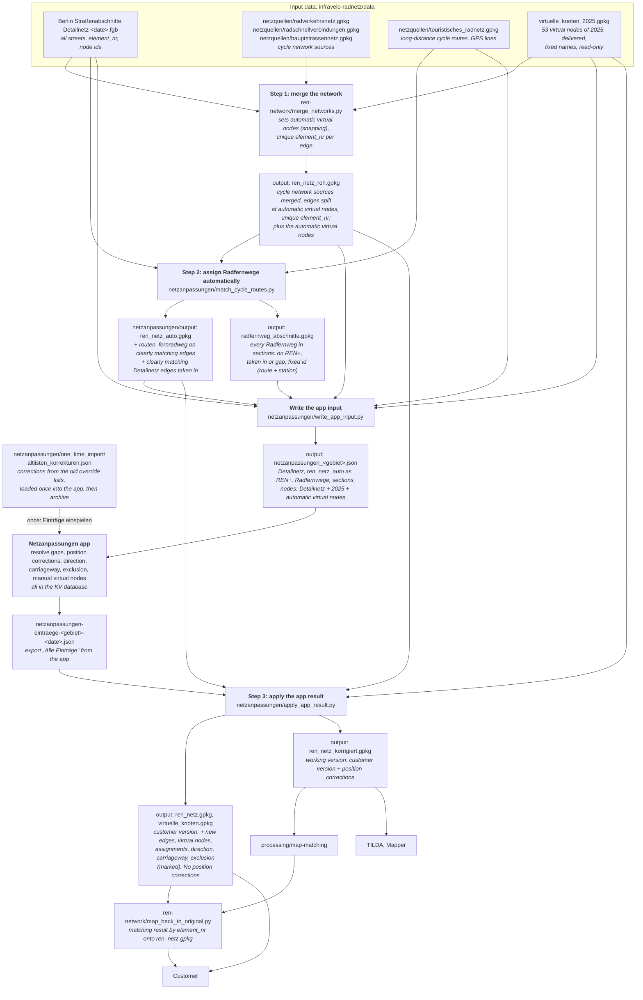

# Network pipeline: from the raw network to the customer network and the working network

As of 2026-11-12. Two repos take part: this repo `infravelo-radnetz` (Python, all network files) and [`knotenpunkte`](https://github.com/FixMyBerlin/knotenpunkte) with the **Netzanpassungen app** (`netzanpassungen/` there, handwork in the KV database). The app itself is described in its [README](https://github.com/FixMyBerlin/knotenpunkte/blob/main/netzanpassungen/README.md).

**Language rule for both repos:** code, comments, file names, commit messages and our documents are in English. The app UI and the customer's data fields (`element_nr`, `verkehrsrichtung`, `routen_fernradweg`, `fahrbahn_typ`, …) stay German.

## Principle

**The Netzanpassungen app sits in the middle of the pipeline and never receives anything from the end of it.** Its input holds only raw data and what is computed automatically. All handwork (new edges, manual virtual nodes, assignments, corrections) lives only in the KV database and is laid onto this raw input at every load. That is why the input file can be regenerated and uploaded at any time: nothing is duplicated, and nothing has to be recognised as "already taken over".

For Python this means: the result of the app is written only to `output/`, never to the input data (`data/`) from which the next app input is built.

## Result

| File                       | Content                                                                                                                                                                                                                                                                                                                                         | For                                                      |
| -------------------------- | ----------------------------------------------------------------------------------------------------------------------------------------------------------------------------------------------------------------------------------------------------------------------------------------------------------------------------------------------- | -------------------------------------------------------- |
| `ren_netz.gpkg`            | Raw network + Radfernwege (assigned automatically and by hand) + newly drawn edges + virtual nodes + direction, carriageway and excluded edges. Everything that comes from the Netzanpassungen app is marked in its own columns (e.g. `quelle_eintrag`, `verkehrsrichtung_korrigiert`, `ausgeschlossen`, `grund`). **No** position corrections. | customer                                                 |
| `ren_netz_korrigiert.gpkg` | like `ren_netz.gpkg`, plus the position corrections (geometry)                                                                                                                                                                                                                                                                                  | matching (`processing/map-matching`) and mapping (TILDA) |

Both also come as the filtered mapping version (`…_kartierung…`). The only difference between the two networks is position: without the columns on the overrides the customer would not understand what we did, which is why they are in the customer version too.

## Diagram

## The steps

Script and file names (renamed with this rebuild):

| before                                                             | now                                     |
| ------------------------------------------------------------------ | --------------------------------------- |
| `ren-network/unify_networks.py`, `netz_zusammenfuehren.py`         | `ren-network/merge_networks.py`         |
| `ren-network/output/ren_netz_gesamt.gpkg`                          | `ren-network/output/ren_netz_roh.gpkg`  |
| `netzanpassungen/radfernwege_zuordnen.py`                          | `netzanpassungen/match_cycle_routes.py` |
| `netzanpassungen/export_app_daten.py`, `app_eingabe_schreiben.py`  | `netzanpassungen/write_app_input.py`    |
| `netzanpassungen/import_app_export.py`, `app_ergebnis_anwenden.py` | `netzanpassungen/apply_app_result.py`   |
| `ren-network/zurueck_aufs_original.py`                             | `ren-network/map_back_to_original.py`   |
| `netzanpassungen/einmalige_uebernahme/`                            | `netzanpassungen/one_time_import/`      |

Output file names stay (`ren_netz_roh.gpkg`, `ren_netz_auto.gpkg`, `radfernweg_abschnitte.gpkg`, `ren_netz.gpkg`, `ren_netz_korrigiert.gpkg`, `ren_netz_kartierung*`, `virtuelle_knoten.gpkg`, `netzanpassungen_<gebiet>.json`).

**Virtual nodes of 2025.** The 53 virtual nodes of 2025 are delivered data with fixed names. They are a fixed, read-only input of step 1 (`data/virtuelle_knoten_2025.gpkg`), like the Detailnetz nodes. They are not imported into the app.

**Step 1: merge the network** (`ren-network/merge_networks.py`). Raw data merge as today: Radverkehrsnetz, Radschnellverbindungen, Hauptstraßennetz; `element_nr` through the node pairs of the Detailnetz. New is the handling of virtual nodes and edge ids. No link to Radfernwege or to the app. Result `ren_netz_roh.gpkg`.

- **Automatic virtual nodes (snapping).** Where the end of an edge lies on the interior of another REN+ edge, a virtual node is set there and that edge is split. A 2025 node close by supplies the name; a loose end gets an end node. Names follow the app: `V<A>-<B>`.
- **Unique `element_nr`.** After that every REN+ edge gets a unique `element_nr` built from its end nodes, and the app uses `element_nr` as the edge ref. Reason (real data): 234 REN+ rows had no `element_nr` and 17 numbers occurred twice, because step 1 only knew the Detailnetz nodes.
- Manual virtual nodes (drawn or set in the app) are not part of step 1: they stay in the KV database of the app and are added in step 3.

**Step 2: assign Radfernwege automatically** (`netzanpassungen/match_cycle_routes.py`). Every Radfernweg is laid onto REN+ and the Detailnetz (rule below). Clearly matching REN+ edges get `routen_fernradweg`. Clearly matching Detailnetz edges that are not in REN+ yet (Markgrafenstraße) are taken in, with `grund_aufnahme = radfernweg`. What is left becomes a **gap** with a fixed id. No handwork in this step.

**Write the app input** (`netzanpassungen/write_app_input.py`). Writes `netzanpassungen_<gebiet>.json` from `ren_netz_auto.gpkg`, the Detailnetz, the Radfernwege and the Radfernweg sections. The nodes (`knoten`) are the Detailnetz nodes plus the 2025 and the automatic virtual nodes (`ist_virtuell = 1`). That is allowed because they are raw or automatic data, not handwork. This file is uploaded in the app, also repeatedly.

**One-time import** (`netzanpassungen/one_time_import/`). Only `altlisten_korrekturen.json`: the 38 corrections from the old override lists. It is loaded once into the app („Einträge einspielen“ in the Gebiet step), then it is archive only; the pipeline never reads the folder. Virtual nodes are no part of it (see above).

**In the Netzanpassungen app** a gap is resolved like this:

- **draw new** where there is no matching edge
- **assign existing edge(s)**, also REN+ or grey Detailnetz edges further away (rerouting). The deviation between the GPS line and the chosen edges is measured (Hausdorff, area) and highlighted for the talk with the customer.
- **no action needed**

An automatically assigned stretch can be rerouted in the app too. In addition come the position corrections, direction, carriageway and exclusion as built, and the manual virtual nodes.

**Step 3: apply the app result** (`netzanpassungen/apply_app_result.py`). Reads `ren_netz_auto.gpkg`, the virtual nodes of steps 1 and 2 and the app export, and writes to `output/`:

- `ren_netz.gpkg` (customer): new edges, virtual nodes with the carrier edges split, gap assignments with their `routen_fernradweg`, direction, carriageway, excluded edges. Every takeover from the app is marked in its own columns, with the id of the KV entry.
- `ren_netz_korrigiert.gpkg` (working): the same plus the position corrections
- `virtuelle_knoten.gpkg`: the 2025 nodes + the automatic nodes + the app nodes; every script that needs virtual nodes reads this file
- `korrekturen_konflikte.csv`

Never into `data/`: whatever lands there would come into the app twice through the next app input.

## Assignment rule Radfernweg → edge

Before, there was no assignment, only gaps: everything within 10 m of any REN+ or Detailnetz edge counted as done, the rest from 20 m on was a gap. Places with a Detailnetz edge but no REN+ edge (Markgrafenstraße) fell through. Since the rebuild `netzanpassungen/match_cycle_routes.py` (step 2) does this. The rule is deliberately generous because the GPS lines are less accurate than the network.

**Fixed (as of 2026-11-11, after a run on all of Berlin):**

| Value                        | Start value | **Fixed**                        | Meaning                                                                                                                                    |
| ---------------------------- | ----------- | -------------------------------- | ------------------------------------------------------------------------------------------------------------------------------------------ |
| Distance                     | 15 m        | **20 m**                         | A support point of the edge (every 5 m) counts as near when it is at most this far from the route                                          |
| Share                        | 70 %        | **60 %**                         | Share of the edge length that must be near **and** parallel                                                                                |
| Angle                        | 30°         | **45°**                          | Acute angle between edge and route (direction over 8 m each) below which they count as parallel                                            |
| Candidates                   | 40–70 %     | **40–60 %**                      | not taken, but proposed first in the app                                                                                                   |
| Rest without route           | –           | **at most 250 m**                | For long edges even a high share is only taken when no more than 250 m stay without route; otherwise candidate                             |
| Detailnetz edge next to REN+ | –           | **at most 50 % already covered** | A Detailnetz edge that is not in REN+ is only taken in when at most half of its length is carried by assigned REN+ edges of the same route |

**No Hausdorff as a criterion:** it measures the largest distance, so a single GPS jump would reject a matching edge. Hausdorff and the 95th percentile (distance from the section to its edges, one-sided) are on every section as `hausdorff_m` and `p95_m`, so strong deviations can be found in QGIS. Over all assigned sections: median 5.8 m (Hausdorff) and 5.1 m (P95), 90 % below 15 and 14 m, largest Hausdorff 28 m.

**Result on Berlin** (8 routes, 278.8 km, of which 240.2 km in Berlin): 769 sections `auf_ren` (153.9 km), 138 `aufgenommen` (31.1 km, 99 Detailnetz edges, 21.9 km), 121 `luecke` (93.8 km, of which 55.4 km in Berlin). REN+ rows with a Radfernweg: 581 (120.0 km edge length), 195 rows with several routes. For comparison the old gap list: 278 gaps, 102.7 km (64.2 km in Berlin). Of the 55.4 km gap in Berlin, 32.9 km have no edge at all within 20 m (the ways are missing in the Detailnetz and in REN+); for 22.5 km an edge lies nearby but is not parallel, too far away, or already carried by REN+. 25 of the 121 gaps have candidates.

### Evidence from the run

**Distance.** The number of assigned edges grows with the distance until it flattens at about 20 m (REN+ kilometres in Berlin at share 70 %, angle 30°: 10 m 118.0 · 15 m 141.7 · 20 m 151.6 · 30 m 154.5). What matters is what is added when the distance grows:

| Step      | new edges | km   | of which on a stretch that another edge of the route already carried |
| --------- | --------- | ---- | -------------------------------------------------------------------- |
| 10 → 15 m | 119       | 24.7 | 1 edge                                                               |
| 15 → 20 m | 44        | 10.1 | 6 (14 %): e.g. Puschkinallee, Grunerstraße                           |
| 20 → 25 m | 18        | 3.4  | 7 (39 %)                                                             |
| 25 → 30 m | 12        | 1.8  | 9 (75 %)                                                             |

Up to 20 m the new edges almost only fill stretches that were empty before (the GPS line runs 15 to 19 m beside a whole edge, e.g. Heerstraße, Schulzendorfer Straße, Straße des 17. Juni, Lindenstraße). Beyond that they are mostly parallel streets. Hence 20 m.

**Share.** The distribution has two strong peaks (REN+, distance 15 m: 660 of 886 route–edge pairs have 90 to 100 %, in between there are only 14 to 47 per 10 % step), so the threshold decides about few edges only. The touchstone is the connection: if an edge is attached to another, surely assigned edge (same end point within 1 m) it probably belongs to the route; an isolated edge is suspicious.

| Share     | edges | connected at both ends | isolated |
| --------- | ----- | ---------------------- | -------- |
| from 70 % | 767   | 80 %                   | 2 %      |
| 60–70 %   | 18    | 44 %                   | 0 %      |
| 50–60 %   | 13    | 23 %                   | 23 %     |
| 40–50 %   | 11    | 0 %                    | 27 %     |

(Distance 20 m, angle 30°.) Down to 60 % the edge looks like a piece of the route, below that no longer: there the route lies on only a part of the edge and then leaves it. So 60 % for "taken", below that down to 40 % candidate. This takes 18 more REN+ edges than 70 %.

**Angle.** Cross streets: 313 REN+ edges and 493 Detailnetz edges have at least one support point within 20 m of the route but are nowhere parallel below 45°; none of them is taken. What the threshold additionally lets in (distance 20 m, share 60 %):

| Angle    | new edges                  | Finding                                                                                                                       |
| -------- | -------------------------- | ----------------------------------------------------------------------------------------------------------------------------- |
| 15 → 20° | 11 (3 isolated)            | curves and GPS spikes                                                                                                         |
| 20 → 30° | 12                         | all connected                                                                                                                 |
| 30 → 45° | 11                         | all connected: roundabouts (Strausberger Platz), square edges                                                                 |
| 45 → 60° | 17, of which 13 Detailnetz | 15 to 19 m long stubs (Angersteinweg, Schloßpark, Nordhafenpark) and ways beside the route (Bulgarische Straße, Betckestraße) |
| 60 → 90° | 55, of which 34 Detailnetz | cross streets, 4 isolated, 10 below 30 m                                                                                      |

Up to 45° only what hangs on the route is added; from 45° the crossing stubs start. Hence 45°.

### Spot checks (all with the fixed values)

The pattern shows the support points of the edge from start to end: `#` near and parallel, `n` near but not parallel, `.` far.

| Case                   | Edge                                                                                        | Share       | Finding                                                                                                                                              |
| ---------------------- | ------------------------------------------------------------------------------------------- | ----------- | ---------------------------------------------------------------------------------------------------------------------------------------------------- |
| just taken             | Alexanderstraße 47550057_47550001.01 (21 m)                                                 | 0.60        | `nn###`: the route turns off at the end; crossing edge of the route, correct                                                                         |
| just taken             | Bahnhofstraße 49630096_49630054.01 (21 m)                                                   | 0.60        | `###nn`: the same                                                                                                                                    |
| just taken             | Strausberger Platz 48540047_48540027.01 (75 m)                                              | 0.60        | roundabout, the GPS line cuts the curve; correct                                                                                                     |
| crossing stub          | Innsbrucker Platz 42500040_42500084.01 (29 m), Puschkinallee 50520043_50520032.01 (27 m)    | 0.67        | short edges at squares, both connected to assigned edges; correct                                                                                    |
| candidate              | An der Wuhlheide 55480001_55480015.01 (191 m, distance 17 m)                                | 0.59        | the first 80 m without route (GPS line jumps); to be decided in the app                                                                              |
| candidate              | Bellevueallee 43540023_43540021.01 (110 m)                                                  | 0.57        | route joins in the middle                                                                                                                            |
| candidate              | Straßentunnel Alexanderplatz 47540406_47550003.01 (693 m)                                   | 0.48        | route runs on the second half only                                                                                                                   |
| candidate (Detailnetz) | Puschkinallee 50510010_50520027.02 (163 m)                                                  | 0.48        | route turns off after 80 m; REN+ already carries the stretch                                                                                         |
| long edge              | Straße zum Müggelhort (Detailnetz, 2452 m)                                                  | 0.60        | 969 m without route: not taken only because of the 250 m limit                                                                                       |
| long edge              | Kladower Damm 31500019_31510004.01 (864 m)                                                  | 0.67        | 285 m without route: candidate as well                                                                                                               |
| GPS distance           | Lindenstraße 68440003_68440016.04 (176 m)                                                   | 1.00        | distance 18.6 m, the whole edge parallel; only taken with 20 m                                                                                       |
| GPS distance           | Großer Stern 42540016_42540018.01 (50 m), Schulzendorfer Straße 58410039_58410025.03 (67 m) | 0.80 / 1.00 | distance 18.4 to 18.5 m; the same                                                                                                                    |
| GPS distance           | Müggelheimer Damm 58460035_59450004.02 (471 m)                                              | 0.76        | `####...............###…`: line 18 m beside it, a jump in the middle; taken                                                                          |
| GPS jump               | Spreeradweg, edge without element_nr (1374 m)                                               | 0.89        | a far piece in the middle (`nnnn###.####…`); taken, exactly what the share should forgive. With Hausdorff as a criterion it would have been rejected |
| GPS jump               | Berlin-Usedom 46580023_46590016.01 (433 m, distance 15.4 m)                                 | 0.64        | the GPS line leaves the edge 150 m before its end; taken                                                                                             |
| parallel street        | Goltzstraße (Detailnetz, three edges, 34 to 109 m)                                          | 1.00        | REN+ already carries the same stretch: not taken in (20 such Detailnetz edges in total)                                                              |
| cross street           | 46550057_47550029.01 (399 m), 47550001_47550003.01 (280 m) and 311 more REN+ edges          | 0           | near, but never parallel below 45°                                                                                                                   |

Small sections: stretches below 25 m of the same state, gaps below 20 m and stretches below 5 m are merged into the neighbouring section. The section id is fixed as long as route, network and these values stay the same; if a value changes, the ids change and old `section_assignment` entries of the app no longer fit (they end up in `korrekturen_konflikte.csv`).

## Decisions (2026-11-11)

1. **Customer version with overrides:** direction, carriageway and excluded edges belong in `ren_netz.gpkg` too, clearly marked as our change. Only the position corrections stay out.
2. **Thresholds** of the assignment rule: set by the implementation after its own check (values above).
3. **Rename** of the scripts and folders together with the rebuild; English names for code, files, comments, commit messages and documents (language rule above).
4. **Virtual nodes of 2025** are delivered data and a read-only input of step 1 (`data/virtuelle_knoten_2025.gpkg`), not imported into the app. Step 1 sets automatic virtual nodes by snapping; manual ones are kept in the app's KV database and added in step 3. `virtuelle_knoten.gpkg` holds all three kinds.
5. **Unique `element_nr`** for every REN+ edge, built in step 1 from its end nodes; the app uses it as the edge ref.
